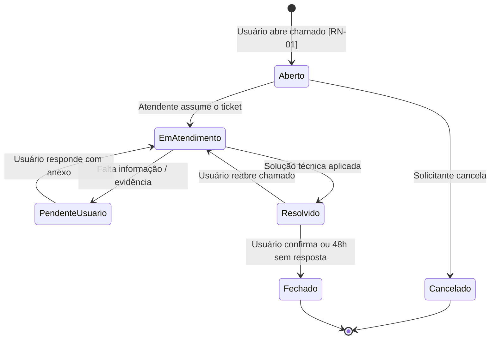
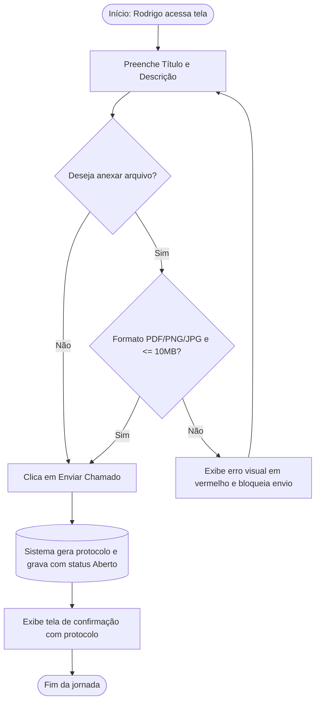

# Skill: Mapear Fluxos e Estados em Mermaid

> 💡 **MECANISMO DE DISPARO:**  
> Use esta skill para transformar regras complexas ou jornadas de tela em diagramas Mermaid claros, diretamente legíveis no Markdown e no Antigravity.

---

## 1. Tipos de Diagramas Suportados

1. **State Diagram (Máquina de Estados):** Para status de entidades, transições permitidas e gatilhos.
2. **Flowchart (Fluxograma de Decisão):** Para jornadas de usuário com ramificações de sucesso e erro.
3. **Sequence Diagram (Interação Funcional):** Para interações de ponta a ponta entre Persona, Interface e Sistema.

---

## 2. Procedimento Passo a Passo

1. **Passo 1 — Identificar Estados e Atores:**
   - Consulte `@contexto/glossario.md` para garantir que apenas os status oficiais sejam usados.
2. **Passo 2 — Mapear os Gatilhos de Transição:**
   - Identifique quem dispara cada mudança (Usuário, Atendente, Sistema/Tempo) e as regras `[RN-XX]` vinculadas.
3. **Passo 3 — Mapear os Ramos de Erro / Cancelamento:**
   - Nunca desenhe apenas o fluxo ideal; inclua sempre os nós de bloqueio, erro e cancelamento.
4. **Passo 4 — Gerar a Sintaxe Mermaid Válida:**
   - Renderize o bloco com crases triplas e a tag `mermaid`.

---

## 3. Gabarito de Saída Didático (Exemplo Neutro)

### Exemplo 1: Máquina de Estados de Chamados

### Exemplo 2: Fluxograma de Decisão da Jornada de Abertura

---

<!--
📋 CHECKLIST DE VALIDAÇÃO:
[ ] Os status batem 100% com o glossário oficial?
[ ] Foram incluídos caminhos de erro e cancelamento?
[ ] A sintaxe Mermaid é válida e sem caracteres incompatíveis?
-->
